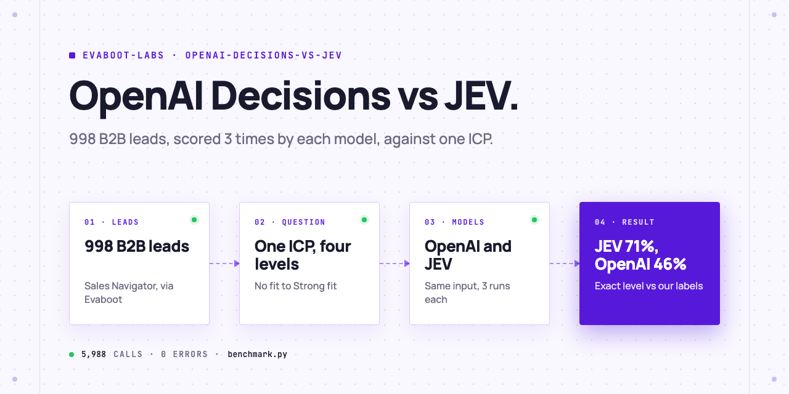
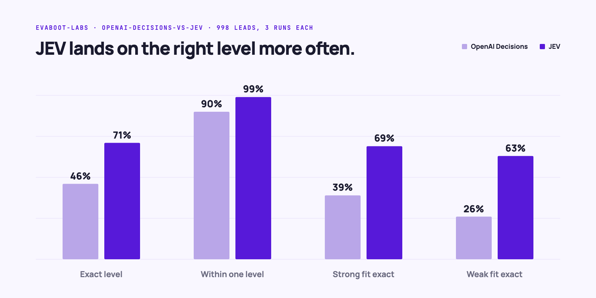
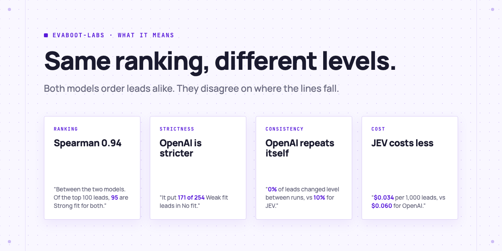

<picture>
  <source media="(prefers-color-scheme: dark)" srcset=".github/assets/banner-dark.png">
  
</picture>

# OpenAI Decisions API vs JEV for lead scoring

A benchmark of two AI decision models on one job: scoring B2B leads against an ideal customer profile. Both get the same input, the same question and the same four fit levels. Run it again on your own leads.

[](AGENTS.md)
[](LICENSE)

## Set it up in one prompt

Paste this into Claude Code, Codex or Cursor:

```text
Compare the OpenAI Decisions API and JEV on my own leads. Clone
https://github.com/evaboot-labs/openai-decisions-vs-jev, read AGENTS.md and follow the
compare-models skill. Show me the labels before you use them, and run a 10-lead test
before the full benchmark.
```

<details>
<summary>Or install the skill</summary>

Claude Code:

```text
/plugin marketplace add evaboot-labs/openai-decisions-vs-jev
/plugin install openai-decisions-vs-jev@evaboot-labs-openai-decisions-vs-jev
```

Codex, Cursor and other agents:

```bash
npx skills add evaboot-labs/openai-decisions-vs-jev
```

</details>

Prefer n8n? Follow [`docs/n8n.md`](docs/n8n.md) to score a Google Sheet with both models, no code.

## How it works

**Results on 998 leads.** Each lead was scored 3 times by each model on 2026-10-20: 5,988 calls, 0 errors. Full tables, per-label accuracy and confusion matrices: [`report.md`](report.md).



| | OpenAI | JEV |
|---|---|---|
| Exact level (vs our labels) | 46% | 71% |
| Within one level | 90% | 99% |
| Mean error (levels 0 to 3) | 0.65 | 0.40 |
| Leads that changed level between runs | 0% | 10% |
| Median response time | 0.27 s | 0.26 s |
| Input tokens per lead | 598 | 819 |
| Cost per 1,000 leads | $0.060 | $0.034 |

- **OpenAI Decisions API**: `POST https://api.openai.com/v1/decisions`, model `gpt-6-luna`.
- **Typesafe JEV**: `POST https://api.typesafe.ai/v1/systemone`, model `jev-latest` (early access).

## Same ranking, different levels

<picture>
  <source media="(prefers-color-scheme: dark)" srcset=".github/assets/findings-dark.png">
  
</picture>

The leads come from 12 Sales Navigator exports, made with [Evaboot](https://evaboot.com), picked to cover every fit level. Limits: one ICP, labels written by us as rules (`label_leads.py`), one day. The lead list itself is not in this repo: those are real people.

## What you need

- **An OpenAI API key** and a **Typesafe JEV key** (JEV is early access, by waitlist).
- **Your leads** in `data/leads.csv` with a correct level for each in `data/labels.csv`. An Evaboot export has every column the benchmark reads.
- **Python 3.9 or later.** No packages to install.
- **Cost:** about 6 cents (OpenAI) and 3 cents (JEV) per 1,000 leads and run.

## Go further

| Page | For |
|---|---|
| [Run it on your own leads](docs/run-on-your-leads.md) | Keys, lead and label files, every script |
| [n8n workflow](docs/n8n.md) | Score a Google Sheet with both models side by side |
| [Full report](report.md) | Per-label accuracy and confusion matrices |

---

Agents: start at [AGENTS.md](AGENTS.md) · Built by [Evaboot](https://evaboot.com) · More workflows at [github.com/evaboot-labs](https://github.com/evaboot-labs) · [MIT license](LICENSE)
